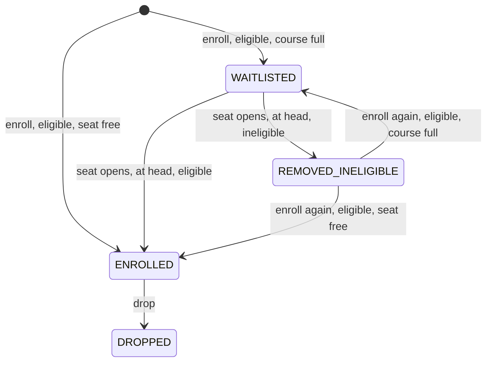

# Design: Math III enrollment and waitlist

## 1. Service boundary

One in-memory Java class, `EnrollmentService`, manages a single offering, Math III. It provides
`enroll`, `drop` (which also promotes), `getStatus` and `snapshot`. The caller supplies the learner directory.
A thin command-line prototype, `Main`, reads one command per line and prints each result so the feature can
be tried by hand; it holds no rules of its own. There is no HTTP layer, frontend, database, catalog or
notification. No starter project was supplied, so this follows the brief's service or CLI fallback.

| Part | Files | Responsibility |
| --- | --- | --- |
| Domain types | `Learner`, `RecordStatus`, `EnrollmentRecord` | Immutable records and an enum. `Learner` validates its id and copies its course set. |
| Result types | `EnrollResult`, `DropResult` | Sealed interfaces with one record per outcome. |
| Eligibility rule | `Eligibility` | Holds "Math I" and "Math II" as constants. `missingPrereqs(learner)` is pure. |
| Enrollment service | `EnrollmentService` | Owns all state, the lock and the invariants. |
| Command-line prototype | `Main` | Starts with five sample learners (one per prerequisite case), parses `learner`, `learners`, `enroll`, `drop`, `status` and `show`, and prints the service's results. |
| Tests | `src/test/java/waitlist` | One class per area, a `Checked` wrapper, `ConcurrencyTest` and `MainTest`. |

## 2. Assumptions

1. **Prerequisite rule.** A learner may take Math III if their completed courses include both "Math I" and
   "Math II". Names match exactly and case-sensitively, and other courses don't matter. Eligibility is checked
   when a learner asks to enroll, and again when they reach the head of the waitlist as a seat opens, because
   completed courses can change while a learner waits (for example after a corrected grade).
2. **Ineligible at request.** The result is `PrereqNotMet` with the missing courses. No record is created, so
   asking again returns `PrereqNotMet` again.
3. **Ineligible at the head: skip and remove.** When a seat opens, an ineligible head gets status
   `REMOVED_INELIGIBLE` and leaves the queue, and the next head is checked. This repeats until someone is
   promoted or the queue is empty. Learners further back are not checked early. A learner with no usable
   directory entry at that moment counts as ineligible.
4. **"Enroll only once" (our interpretation).** We read the brief's "A learner may enroll only once" as
   "hold a seat at most once". A learner who held a seat and dropped it is `DROPPED`, which is final: enroll
   returns `AlreadyDropped`. A learner removed as ineligible never held a seat, so they may ask again and are
   handled like a first request (back of the queue if full). The other reading, "no duplicate records at the
   same time", would allow re-enrollment after a drop; we rejected it.
5. **"Joins the waitlist once" (AC 2)** means one entry at a time. A repeat request returns `AlreadyEnrolled`
   or `AlreadyWaitlisted(position)` and changes nothing.
6. **Drop applies only to enrolled learners.** A second drop returns `DropResult.AlreadyDropped`. Dropping a
   waitlisted or never-enrolled learner returns `NotEnrolled`. There is no waitlist withdrawal. An enrolled
   learner who later loses eligibility keeps the seat.
7. **FIFO** is the order in which calls acquire the lock, not wall-clock arrival. Positions are 1-based.
8. **Capacity** is fixed at construction and must be at least 1. The waitlist has no size limit.
9. **Input.** A valid id is non-null, non-empty, and has no leading or trailing whitespace. `Learner` applies
   the same rule, so every learner that can be built can be reached. Requests never throw: a bad id returns
   `InvalidRequest`, and an id with no record and no usable directory entry returns `UnknownLearner`. A
   directory entry counts only if its key equals its learner's id. Invalid configuration (capacity below 1,
   a bad learner id, a blank course name, nulls) throws at construction.

## 3. Data model and API

State, all guarded by one lock: a `HashSet` of enrolled ids, an `ArrayList` waitlist (head at index 0), one
immutable `EnrollmentRecord(learnerId, status, waitlistSeq)` per learner, replaced whole on every change, and a
sequence counter. `waitlistSeq` is set only while `WAITLISTED`. The learner directory is the caller's
`Map<String, Learner>`, held by reference and only read. `snapshot()` returns an immutable copy for tests.

```java
public EnrollmentService(int capacity, Map<String, Learner> learners)
public EnrollResult enroll(String learnerId)
public DropResult drop(String learnerId)
public Optional<EnrollmentRecord> getStatus(String learnerId)
public Snapshot snapshot()
```

| `EnrollResult` | `DropResult` |
| --- | --- |
| `Enrolled`, `Waitlisted(position)` | `Dropped(promoted, skippedIneligible)` |
| `AlreadyEnrolled`, `AlreadyWaitlisted(position)`, `AlreadyDropped` | `NotEnrolled`, `AlreadyDropped` |
| `PrereqNotMet(missing)`, `UnknownLearner`, `InvalidRequest(reason)` | `UnknownLearner`, `InvalidRequest(reason)` |

**Qualified-name rule.** `AlreadyDropped`, `UnknownLearner` and `InvalidRequest` exist in both interfaces, so
code always writes the qualified name, for example `DropResult.AlreadyDropped`. Importing both by short name
would not compile.

## 4. Learner lifecycle



Rejected requests (`InvalidRequest`, `UnknownLearner`, `PrereqNotMet`, `Already…`, `NotEnrolled`) cause no
transition. `DROPPED` is final.

## 5. Promotion rule

Every check runs before the first change to state, and both operations read the learner's record before the
directory, so an enrolled learner can always drop. A drop frees exactly one seat and fills it in the same call:

```
drop(id): validate id; if DROPPED -> AlreadyDropped; if unknown -> UnknownLearner;
          if not ENROLLED -> NotEnrolled; free the seat, mark DROPPED, then:
  while waitlist not empty:
    head = waitlist.remove(0)
    if head is in the directory and has Math I and Math II: enroll head, return Dropped(head, skipped)
    mark head REMOVED_INELIGIBLE; skipped.add(head)
  return Dropped(none, skipped)
```

## 6. Invariants

Checked by the `Checked` test wrapper after every `enroll` and `drop`, and again at the end of each test:

1. `capacity >= 1`
2. `enrolled.size() <= capacity`
3. No learner is both enrolled and waitlisted; nobody is waitlisted twice.
4. Status agrees with the indexes: `ENROLLED` ⇔ in `enrolled`, `WAITLISTED` ⇔ in `waitlist`.
5. A non-empty waitlist means the course is full, so nobody jumps the queue.
6. Only `WAITLISTED` records carry a `waitlistSeq`, strictly increasing from head to tail (FIFO).

## 7. Concurrency and persistence

- One private, non-fair `ReentrantLock`. `enroll`, `drop`, `getStatus` and `snapshot` hold it for their whole
  body, so each call is atomic, including the promotion inside a drop. A fair lock would cost throughput and
  still wouldn't give arrival order.
- **Threading contract.** The lock protects the service's own state, not the caller's learner directory. If
  other threads update learners while calls run, the caller passes a `ConcurrentHashMap` and replaces whole
  (immutable) entries.
- The brief asks for a concurrency test only when a starter is concurrent. There is no starter, but a Java
  object can be shared across threads, so `ConcurrencyTest` adds two small cases: 200 learners enrolling into
  10 seats at once, and 10 seat holders dropping while 20 newcomers enroll. Every task's `Future.get()` is
  checked, so an exception in a worker fails the test, and timeouts turn a hang into a failure.
- No persistence. With a database, each operation would run in one transaction that row-locks the offering,
  plus a unique index on `(offering_id, learner_id)` for active statuses.

## 8. Rejected alternatives

| Alternative | Why not |
| --- | --- |
| Skip and retain an ineligible head | A seat could sit open while the waitlist is non-empty, breaking invariant 5 |
| Fix eligibility at request time only | The brief asks what happens when an ineligible learner reaches the front |
| Allow re-enrollment after a drop | Conflicts with our reading of "enroll only once" |
| Waitlist withdrawal through drop | Not asked for; one more state and branch |
| Exceptions for invalid requests | AC 5 asks for clear results; only configuration errors throw |
| Copy the directory behind an update method | Adds an operation the brief doesn't ask for; the lookup check and the contract are enough |
| HTTP layer, fair lock, `synchronized` on the instance | Out of scope; throughput cost; outside code could block the service |
